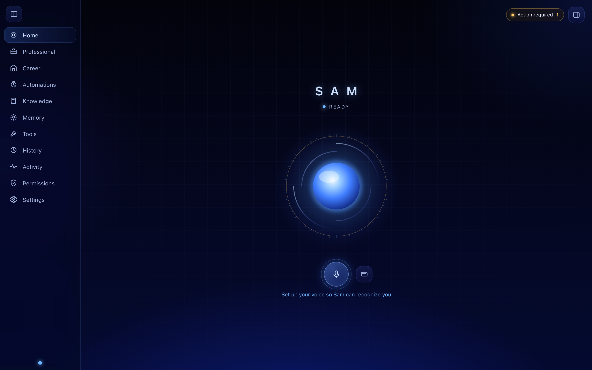
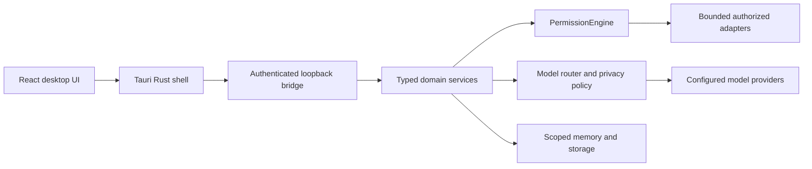

# Sam

**A personal AI desktop assistant with local voice processing and explicit permissions.**

Sam combines a React + Tauri desktop interface with a typed Python/FastAPI
backend. It brings together conversation, source-attributed knowledge, scoped
memory, professional evidence, and review-first career workflows. A
deterministic permission engine decides what an operation may do; model output
and voice recognition do not grant authority.

> **Development status:** Phase 17 production hardening is pending independent
> re-review and is **not approved**. Short-phrase owner voice verification remains
> unreliable. Sam is under active development, not a production-ready release.

[Get started](#get-started) · [Architecture](docs/architecture.md) ·
[Development](docs/development.md) · [Roadmap](docs/roadmap.md) ·
[Contributing](CONTRIBUTING.md)

## Interface preview



*Development preview using the built-in synthetic setup fixture at commit
`f0e46ab`. No owner data or live voice verification is shown.*

## What is here today

| Area | Implemented scope and limits |
| --- | --- |
| Desktop | React/TypeScript interface in a Tauri/Rust shell, connected to a bounded local backend bridge. |
| Voice | Optional local wake recognition, speaker verification and multilingual transcription on macOS/Apple silicon; native macOS speech and optional configured cloud speech. Brief owner utterances can still fail verification. |
| Model routing | Policy-driven provider selection, readiness and privacy controls. Explicit OpenRouter configuration can use paid credits; automatic paid fallback is off. |
| Knowledge and memory | Separate domains for source-attributed document retrieval and policy-checked personal memory. They do not automatically absorb every conversation. |
| Professional and career | Evidence-backed professional claims and review-first application/outreach drafts. Real submission and email adapters remain unavailable. |
| Automations | Bounded reminders, summaries and condition watches with an in-app inbox. They do not inherit permission to send, submit or purchase. |
| Production hardening | Local SQLite persistence, recovery and backup mechanisms under Phase 17 review. Their presence is not release approval. |
| Computer, coding and MCP | Permission-checked foundations; availability depends on configured, reviewed adapters. This is not an unrestricted computer-control agent. |

## Get started

### Backend development

Install Python **3.12+** and [uv](https://docs.astral.sh/uv/), then:

```bash
git clone https://github.com/SamSamaei73/Sam.git
cd Sam
uv sync --frozen
cp -n .env.example .env
make run
```

In another terminal:

```bash
curl --fail http://127.0.0.1:8000/health
```

The development server defaults to loopback (`127.0.0.1:8000`). The health
endpoint does not require a hosted model. Agent replies require a configured
provider; see [model routing and OpenRouter setup](docs/model-routing.md).
OpenRouter requests consume the owner's configured balance. Keep credentials
in local configuration, outside version control.

### Explore the interface

Use **Node.js 22.22.2+ within the 22.x line** for the locked desktop toolchain
(22.23.2 was used for the documentation preview).

```bash
cd desktop
npm ci
npm run dev -- --host 127.0.0.1
```

Open the local URL printed by Vite. In a plain development browser, Sam uses
its existing **demo bridge**: displayed replies and capability states are
synthetic. This preview needs no model key and does not demonstrate real
speaker verification or backend authorization. See the
[development guide](docs/development.md) for the real Tauri app, local voice
setup and verification commands.

## Architecture at a glance



This is a map of boundaries, not an autonomous execution loop. The webview,
language models, retrieved documents and tool results are untrusted inputs.
The [architecture overview](docs/architecture.md) maps these boundaries to
source directories and explains the review constraints.

## Documentation

| Start with | Then explore |
| --- | --- |
| [Architecture](docs/architecture.md) | [Permission model](docs/permissions.md), [privacy](docs/privacy.md), [security notes](SECURITY.md) |
| [Development and checks](docs/development.md) | [Desktop bridge](docs/desktop.md), [production hardening](docs/production-hardening.md) |
| [Voice activation](docs/voice-activation.md) | [Owner identity](docs/voice_identity.md), [Persian and language behavior](docs/persian.md), [speech output](docs/tts.md) |
| [Knowledge](docs/knowledge.md) | [Memory](docs/memory.md), [Obsidian](docs/obsidian.md) |
| [Professional evidence](docs/professional-intelligence.md) | [Career and PhD workflows](docs/career-phd-agent.md), [automations](docs/proactive-agent.md) |
| [Roadmap](docs/roadmap.md) | [Phase history](docs/phase-history.md), [architectural specification](PROJECT_SPEC.json) |

## Contribute

Use a focused branch and pull request for a real improvement. Include the
problem, evidence and relevant verification. Read [CONTRIBUTING.md](CONTRIBUTING.md)
before changing permission, voice-identity, storage or provider boundaries.
Existing phase review requirements remain in force.

## License and releases

No project license has been selected in this repository. Do not infer an
open-source license from its public visibility. License selection remains an
owner decision. There is no published GitHub release at this documentation
update; the roadmap describes the work that precedes a reviewed release.
