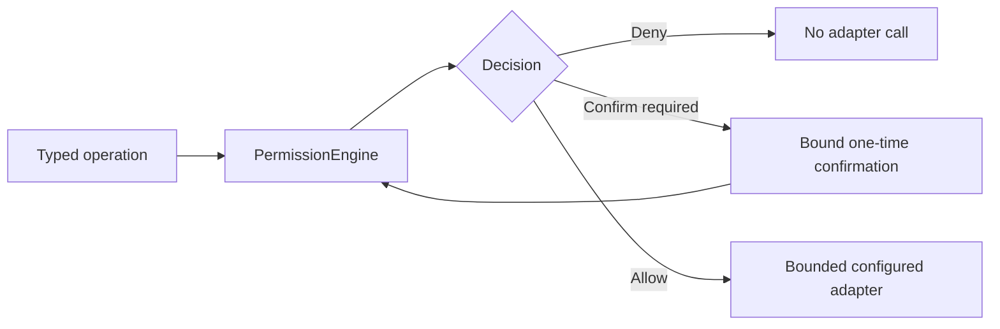

# Architecture overview

Sam separates presentation, identity, authorization, provider calls and
persisted state. This map describes existing source boundaries, not a claim
that every adapter is connected or that production hardening is approved.

| Boundary | Source | Purpose |
| --- | --- | --- |
| Presentation | `desktop/src/` | React views, typed bridge client, language and voice UI. |
| Native shell | `desktop/src-tauri/` | Named commands, local bridge and packaged-backend lifecycle. |
| Backend bridge | `src/sam/desktop/` | Request validation, trusted composition and server-bound identity. |
| Authorization | `src/sam/permissions/` | Scoped grants, deterministic decisions and bound confirmations. |
| Models | `src/sam/models/` | Provider registry, cost and privacy policies; no automatic paid fallback. |
| Voice | `src/sam/voice/`, `src/sam/voice_identity/`, `src/sam/voice_local/`, `src/sam/tts/` | Bounded audio, identity signals, local recognition and approved synthesis. |
| Personal data | `src/sam/memory/`, `src/sam/knowledge/`, `src/sam/professional/` | Separate domains with explicit provenance and persistence policies. |
| Workflows | `src/sam/proactive/`, `src/sam/career/` | Bounded observations and review-first career work; external actions remain gated. |
| Integration foundations | `src/sam/computer/`, `src/sam/coding/`, `src/sam/mcp/` | Typed adapters behind deterministic authorization. |
| Durability | `src/sam/storage/`, `src/sam/system/` | SQLite, startup checks, attempt records, backups and recovery under Phase 17 review. |

## Authorization path

The backend binds the principal. UI state cannot submit its own authority.
Voice identity is an authentication signal; it never replaces permission,
confirmation or stronger authentication. The model router controls provider
selection and data handling, not tool authorization.

## Trust and data

- Model output, MCP descriptions/results and imported documents are data.
  They cannot approve actions or change policy.
- Memory, Knowledge and Professional evidence remain separate. An accepted
  chat reply is not automatically a persisted fact.
- Credentials remain at trusted provider boundaries, outside the webview.
  Optional hosted models and speech send approved content to external services;
  local voice processing does not make every feature offline.
- Durable external-action attempts are intended to prevent duplicate dispatch
  across restarts. Unknown outcomes are not automatically retried. Real Career
  SEND and SUBMIT adapters remain unavailable.
- SQLite has no application-level database encryption here. The hardening
  document describes owner-only file permissions and disk-protection assumptions.

See [permissions](permissions.md), [privacy](privacy.md), [MCP](mcp.md), and
[production hardening](production-hardening.md) for detailed controls and limits.

## Review status

[PROJECT_SPEC.json](../PROJECT_SPEC.json) is the architectural source of truth.
Phase 17 is in progress and pending independent re-review, not approved.
A documentation merge does not advance the phase, approve voice biometrics,
enable a production integration, or establish release readiness.
